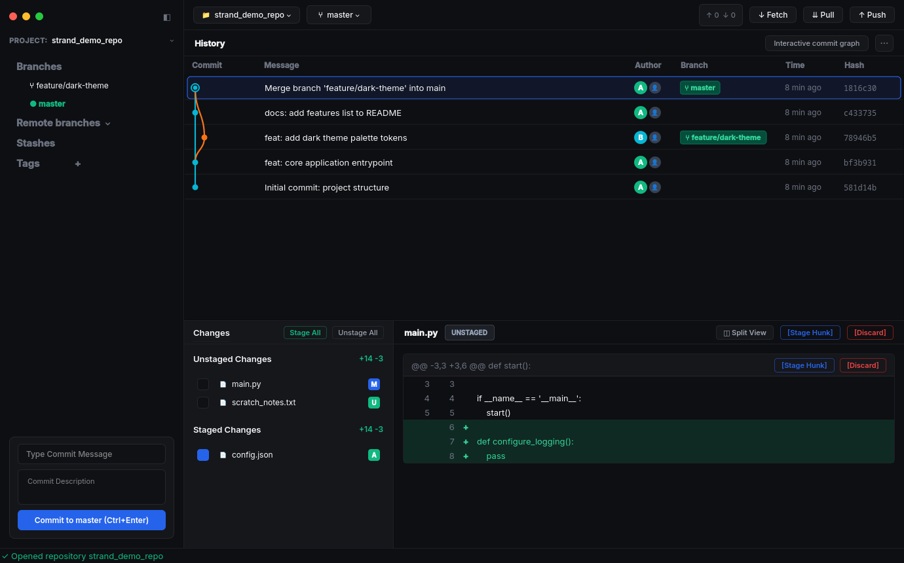
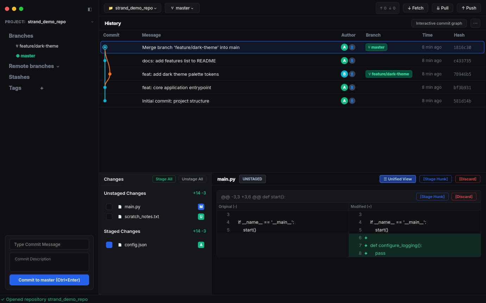
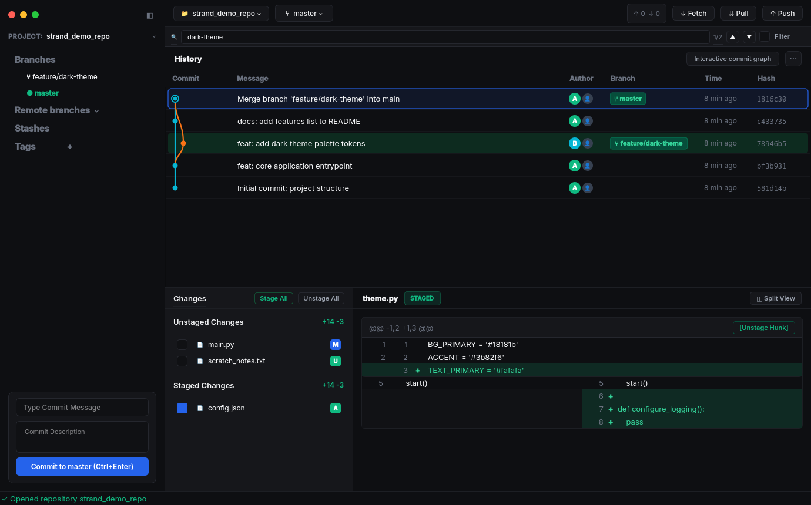

# Strand

<div align="center">

**A modern, high-performance desktop Git client built with Python 3, Qt6 (PySide6), and libgit2.**

[](https://www.python.org/)
[-41CD52?logo=qt&logoColor=white)](https://wiki.qt.io/Qt_for_Python)
[](https://libgit2.org/)
[](LICENSE)
[](https://github.com/)
[](https://deepmind.google/)

</div>

---

## Overview

**Strand** is an open-source, production-grade desktop Git client designed for speed, clarity, and zero-distraction workflows. Inspired by the clean, low-contrast aesthetics of modern developer tools, Strand replaces disruptive modal dialogs with a fluid single-window workspace.

Whether navigating complex merge histories through interactive Bézier commit lanes, performing hunk-level staging, or resolving three-way merge conflicts, Strand delivers a responsive, tactile Git experience.

---

## Screenshots

<div align="center">

### Main Interface & Unified Diff
*Fluid single-window layout featuring the topological DAG commit graph with cubic Bézier tracks, docked sidebar commit authoring, staged/unstaged changes, and hunk-level diff staging.*



<br/>

### Side-by-Side Split Diff View
*Toggle seamlessly between unified and side-by-side diff comparisons with dedicated line gutters and granular hunk controls.*



<br/>

### Commit Graph Search & Highlighting
*Real-time query search across commit summaries, messages, authors, emails, and hashes with match cycling and live graph filtering.*



</div>

---

## Key Features

- **Docked Sidebar Commit Authoring**: The commit box is docked neatly at the base of the left sidebar, giving you immediate access to write commit summaries, extended descriptions, and commit changes with <kbd>Ctrl</kbd>+<kbd>Enter</kbd> without obscuring diffs.
- **Topological DAG Commit Graph**:
  - Topological sorting with descending timestamp order.
  - Dynamic lane assignment and recycling algorithm for compact graph widths.
  - Smooth cubic Bézier spline connectors representing branches and merge tracks.
  - High-performance custom rendering powered by `QPainter` and `QAbstractScrollArea`.
  - Live search and filter mode across commit hashes, summaries, authors, and emails.
- **Granular Staging & Diff Viewer**:
  - **Unified & Split Views**: Toggle between unified diffs and side-by-side split comparison views with a single click.
  - **Hunk-Level Staging**: Selectively stage, unstage, or discard individual diff hunks with automatic byte-level LF line-ending normalization.
  - **Batch Actions**: Convenient `Stage All` and `Unstage All` buttons for rapid workspace sync.
- **Collapsible Sidebar**: Collapse the left sidebar for maximum graph viewing area, and restore it instantly using the persistent edge arrow button.
- **Interactive 3-Way Merge Conflict Resolver**:
  - Visual conflict block parser with clear demarcations between *Ours* and *Theirs*.
  - Inline resolution triggers: `Accept Ours`, `Accept Theirs`, `Use All Ours`, `Use All Theirs`, and `Mark Resolved`.
- **Stash Management**:
  - Stash working changes with custom messages, untracked files (`-u`), and index preservation (`--keep-index`).
  - View, apply, pop, and drop stashes from an interactive manager.
- **Dual-Tier Loading System**:
  - Fast, everyday operations show non-intrusive status indicators in the lower status bar.
  - Heavy tasks (opening large repositories, generating complex diffs) display a full-window dimmed modal overlay card with an animated spinner, preventing state corruption.
- **Zero-Modal Workflow**: Core daily operations occur inline in the main window to preserve developer flow.

---

## Technology Stack

Strand is built on a modern, high-performance Python and Qt foundation:

| Layer | Component | Details |
|:---|:---|:---|
| **GUI Framework** | [PySide6 (Qt6)](https://wiki.qt.io/Qt_for_Python) | Official Qt 6.7+ bindings, providing hardware-accelerated 2D painting (`QPainter`), flexible splitters, and custom widgets. |
| **Git Engine (Primary)** | [pygit2](https://www.pygit2.org/) | Python bindings to **libgit2** for direct in-process access to the Git object database, tree walks, and diff trees. |
| **Git Engine (Fallback)** | Git CLI Streaming | Asynchronous subprocess runner for operations requiring system Git configuration, remote credentials, or streaming hooks. |
| **Diff & Syntax** | [unidiff](https://github.com/matiasb/python-unidiff) & [Pygments](https://pygments.org/) | Patch parsing, hunk extraction, line-number mapping, and syntax highlighting. |
| **Concurrency** | Qt Concurrent / `QThreadPool` | Single-writer FIFO background workers prevent UI freezing and eliminate `.git/index.lock` contention. |
| **Filesystem Watcher** | `QFileSystemWatcher` | Multi-path directory and file monitoring with debouncing to automatically refresh state when files change externally. |
| **Build & Packaging** | `setuptools` & [PyInstaller](https://pyinstaller.org/) | Standard PEP 621 packaging alongside standalone executable generation support. |

---

## AI Disclosure

In the spirit of open-source transparency, **Strand was developed and refined using agentic AI coding assistants** (Google DeepMind's Antigravity environment powered by advanced Gemini models) in collaboration with human software engineers.

- **Human-in-the-Loop Architecture**: System design, dataflow paradigms, thread-safety models, and UX requirements are guided by human maintainers.
- **AI-Assisted Implementation**: Code generation, refactoring, PyQt widget composition, and test suites are developed in close iteration with AI agents.
- **Quality Assurance**: All AI-assisted contributions undergo strict type checking, automated test runs (`pytest`), and manual UX validation.

---

## Prerequisites

Before installing Strand, ensure the following are installed on your system:

- **Python 3.11** or **Python 3.12**
- **Git 2.25+** (available in your system `PATH`)
- **System Libraries (Linux only)**:
  - Debian / Ubuntu:
    ```bash
    sudo apt-get update
    sudo apt-get install -y build-essential python3-dev libgit2-dev libgl1 libegl1
    ```
  - Fedora:
    ```bash
    sudo dnf install -y gcc python3-devel libgit2-devel mesa-libGL
    ```
  - Arch Linux:
    ```bash
    sudo pacman -S base-devel python libgit2 mesa
    ```

---

## Installation & Setup

### Option 1: Fast Setup with `uv` (Recommended)

[`uv`](https://github.com/astral-sh/uv) provides near-instantaneous virtual environment and package installation:

```bash
# Clone the repository
git clone https://github.com/AdilDevStuff/Strand.git
cd strand

# Create virtual environment and install Strand with development dependencies
uv venv
source .venv/bin/activate    # On Windows: .venv\Scripts\activate
uv pip install -e ".[dev]"

# Launch Strand
python main.py
```

### Option 2: Standard `venv` and `pip`

```bash
# Clone the repository
git clone https://codeberg.org/AdilDevStuff/Strand
cd strand

# Create virtual environment
python3 -m venv .venv

# Activate environment
source .venv/bin/activate    # On Linux / macOS
# On Windows (PowerShell): .venv\Scripts\Activate.ps1
# On Windows (cmd.exe):    .venv\Scripts\activate.bat

# Install package in editable mode
pip install --upgrade pip
pip install -e ".[dev]"

# Run Strand
python main.py
```

### Quick Launch Scripts

Platform-specific launcher scripts are provided at the root of the repository:
- **Linux / macOS**: `./run.sh [optional_repo_path]`
- **Windows (PowerShell)**: `.\run.ps1 [optional_repo_path]`
- **Windows (Command Prompt)**: `run.bat [optional_repo_path]`

---

## Building & Packaging Standalone Binaries

Strand includes a unified build system (`build.py` / `strand.spec`) to generate production-ready standalone executables, distribution archives, Python wheels, and checksums:

```bash
# Build standalone bundle and compressed archive (.tar.gz on Linux, .zip on Windows)
python build.py

# Clean previous artifacts and build both standalone binary and Python packages (sdist + wheel)
python build.py --clean --package

# Inspect built artifacts in dist/
ls -lh dist/
```

All generated release assets and SHA256 hashes are placed into `dist/`:
- `strand-<version>-<platform>-<arch>.tar.gz` (or `.zip`): Standalone zero-dependency executable bundle
- `strand-<version>-py3-none-any.whl`: Standard Python wheel distribution
- `strand-<version>.tar.gz`: Source distribution (sdist)
- `SHA256SUMS.txt`: Cryptographic checksums

---

## GitHub CI/CD & Automated Releases

Continuous integration and automated release generation are powered by **GitHub Actions** (`.github/workflows/`):

- **Continuous Integration (`ci.yml`)**:
  - Automatically runs the full test suite (`pytest`) on Linux and verifies packaging on every commit to `main` and Pull Request.
- **Automated Releases (`release.yml`)**:
  - Triggered automatically whenever a version tag (`v*`) is pushed.
  - Builds standalone binaries, source distributions, Python wheels, computes cryptographic checksums, and publishes a new **GitHub Release** with generated release notes.

For more details on releases, see the [GitHub Actions Guide](docs/GITHUB_ACTIONS.md).

---

## CLI Usage

Strand accepts command-line arguments for quick repository launching and diagnostic modes:

```bash
# Open current working directory repository
strand .

# Open a specific repository path
strand /path/to/my/project

# Display version and engine backend information
strand --version

# Run with software rendering (useful for virtual machines or Wayland compatibility)
strand --software-rendering

# Enable verbose logging
strand --log-level DEBUG
```

---

## Keyboard Shortcuts

| Shortcut | Action |
|:---|:---|
| <kbd>F5</kbd> | Refresh repository status and tree |
| <kbd>Ctrl</kbd> + <kbd>O</kbd> | Open repository folder dialog |
| <kbd>Ctrl</kbd> + <kbd>F</kbd> | Focus commit graph search & filter bar |
| <kbd>Ctrl</kbd> + <kbd>Shift</kbd> + <kbd>S</kbd> | Open saved stashes management dialog |
| <kbd>Ctrl</kbd> + <kbd>`</kbd> | Open system terminal in repository root |
| <kbd>Ctrl</kbd> + <kbd>P</kbd> | Push commits to upstream remote |
| <kbd>Ctrl</kbd> + <kbd>Shift</kbd> + <kbd>P</kbd> | Pull commits from upstream remote |
| <kbd>Ctrl</kbd> + <kbd>Shift</kbd> + <kbd>F</kbd> | Fetch latest refs from remotes |
| <kbd>Ctrl</kbd> + <kbd>Enter</kbd> | Commit staged changes (when in commit box) |
| <kbd>F1</kbd> | Show keyboard shortcuts cheat sheet |

---

## Running the Test Suite

Strand includes comprehensive unit and integration tests covering the core engine, DAG graph builder, reactive services, and UI components:

```bash
# Run all tests
pytest -v

# Run specific test suites
pytest tests/test_core.py -v          # Libgit2 engine & DAG topology tests
pytest tests/test_services.py -v      # Worker thread & filesystem watcher tests
pytest tests/test_ui.py -v            # UI components and viewports
pytest tests/test_widgets.py -v       # Custom widgets (CommitBox, DiffViewer, etc.)
pytest tests/test_advanced_git.py -v  # Stash, merge conflicts, search, and history
pytest tests/test_main_window.py -v   # Full window lifecycle tests
pytest tests/test_main.py -v          # CLI argument parser and launch tests
```

---

## Contributing

Contributions from the community are warmly welcome! To contribute:

1. **Fork** the repository and create a feature branch (`git checkout -b feature/amazing-feature`).
2. Follow **PEP 8** style guidelines and maintain full type annotations (`mypy` compatible).
3. Ensure all existing tests pass and add unit tests for new features (`pytest`).
4. Commit your changes with clear, imperative messages.
5. Open a **Pull Request** explaining your changes.

---

## License

Distributed under the **MIT License**. See [LICENSE](LICENSE) for more information.
